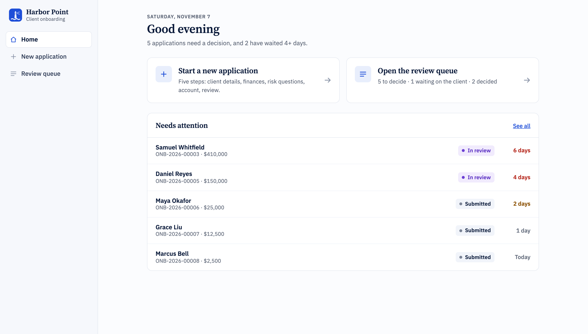
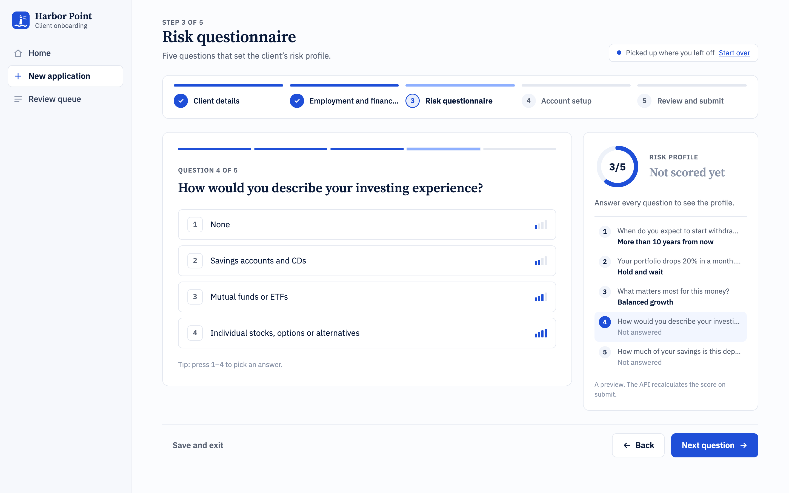
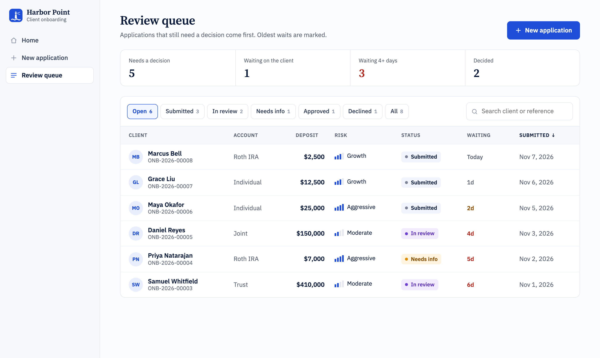
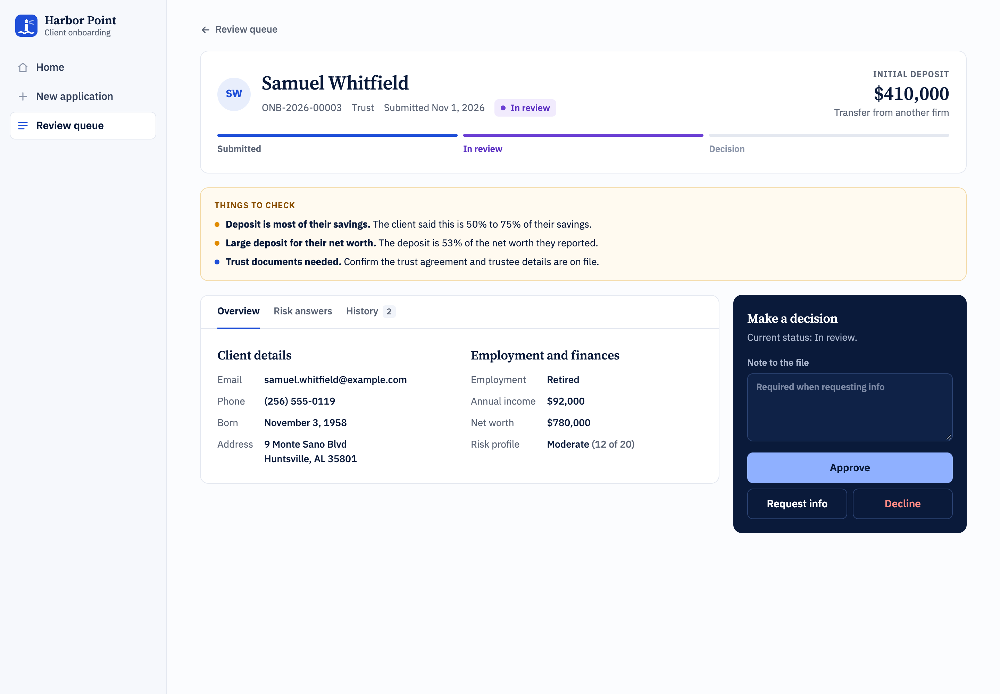
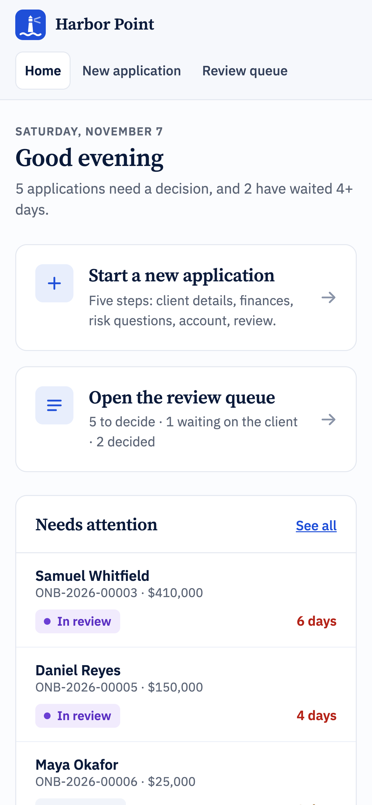

# Client Onboarding Workflow

A full-stack onboarding tool for a fictional wealth management firm, Harbor Point. An advisor walks a new client through a five-step application, the client gets a risk profile from a short questionnaire, and operations staff review the application in a queue and approve it, decline it or request more information.

Built with **Angular 19** and **ASP.NET Core 8 Web API**.



<table>
  <tr>
    <td width="50%"></td>
    <td width="50%"></td>
  </tr>
  <tr>
    <td><b>Risk questionnaire.</b> One question at a time, with keyboard shortcuts and a live profile preview.</td>
    <td><b>Review queue.</b> Status filters, sorting, and how long each application has waited.</td>
  </tr>
  <tr>
    <td width="50%"></td>
    <td width="50%" align="center"></td>
  </tr>
  <tr>
    <td><b>Application detail.</b> Flags for the reviewer to check, and only the decisions the current status allows.</td>
    <td><b>On a phone.</b> Every screen works down to 375px wide.</td>
  </tr>
</table>

<sub>Screenshots use fictional demo data.</sub>

## What it does

- **Home page** that summarizes the review queue, lists the applications waiting longest, and picks up an unfinished application where it left off.
- **Multi-step application** with per-step validation, a stepper you can use to jump back to finished steps, formatted phone and money inputs, and an editable summary before submitting.
- **Risk questionnaire** served by the API, shown one question at a time (number keys 1–4 pick an answer), with a live profile preview (Conservative, Moderate, Growth, Aggressive).
- **Draft autosave**: progress is saved in the browser, so refreshing the page or choosing “Save and exit” doesn’t lose a half-finished application.
- **Review queue** with status filters, search, sorting by deposit or wait time, and days-waiting warnings at 2 and 4 days.
- **Application detail** with Overview, Risk answers and History tabs, plus “Things to check” flags (for example, a deposit that is most of the client’s savings, or a trust account that needs documents).
- **Light and dark themes**: pick Light, Dark or System from the sidebar. The choice is remembered on the device.
- **Review workflow rules** enforced on the server: an application has to be in review before it can be approved, and requesting info requires a note. Declining asks for confirmation and a reason.

## Tech stack

| Layer | Tools |
| --- | --- |
| Front end | Angular 19 (standalone components, signals, new `@if`/`@for` control flow), typed reactive forms, RxJS, SCSS |
| Back end | ASP.NET Core 8 Web API, controllers, DataAnnotations validation, dependency injection |
| Testing | Jasmine + Karma (validators, scoring, form-to-request mapping, review flags, queue timing, input formatting, drafts, app shell) |

## Running it locally

You need the [.NET 8 SDK](https://dotnet.microsoft.com/download) and [Node.js 20+](https://nodejs.org).

```bash
# Terminal 1: the API, on http://localhost:5044
cd api
dotnet run

# Terminal 2: the Angular app, on http://localhost:4200
cd web
npm install
npm start
```

The Angular dev server proxies `/api` to the .NET app (see `web/proxy.conf.json`), so there’s no CORS setup to worry about. The API seeds three sample applications in development so the review queue isn’t empty.

Run the front-end tests with `npm test` in `web`. `api/OnboardingApi.http` has ready-made requests for every endpoint, including one that fails validation on purpose.

## API

| Method | Route | Purpose |
| --- | --- | --- |
| GET | `/api/risk-questions` | Questionnaire the wizard renders |
| POST | `/api/applications` | Submit an application. Returns 201, or 400 with field errors |
| GET | `/api/applications?status=` | Queue, optionally filtered by status |
| GET | `/api/applications/{id}` | Full application with history |
| GET | `/api/applications/{id}/next-statuses` | Which decisions are allowed from the current status |
| PATCH | `/api/applications/{id}/status` | Record a decision. Returns 409 if the move isn’t allowed |

## Design decisions

**The server is the source of truth for business rules.** The Angular app validates for a fast, friendly experience, but the API re-checks everything: field formats, minimum age, that every risk question was answered once, and that the client accepted the agreement. The client’s risk score is only a preview; the stored score is calculated by the API.

**Review statuses are a small state machine** (`StatusRules.cs`). The API also exposes the allowed next statuses, so the UI shows only valid actions instead of duplicating the rules in TypeScript.

**One typed form, split across steps.** The wizard owns a single `FormGroup` with a nested group per step, and each step component receives only its own group. The risk questions arrive from the API at runtime, so they live in a `FormRecord` that gets one control per question.

**Conditional validation.** The employer field is only required for employed or self-employed clients. The financial step swaps its validators when employment status changes.

**Cancelling stale requests.** The review queue uses `switchMap` when the filter changes, so a slow response for an old filter can’t replace newer results.

**Repository interface.** Data access goes through `IApplicationRepository`. It’s backed by an in-memory store today, and its async signatures are already shaped for EF Core, so a database can be added without changing the service or controllers.

## Project structure

```
api/
  Controllers/   HTTP endpoints
  Services/      Onboarding rules, risk scoring, status rules
  Data/          Repository interface, in-memory store, seed data
  Models/        Request DTOs and stored records
web/src/app/
  core/          API service, models, validators, display labels, risk scoring
  home/          Home page
  wizard/        The five-step application, its step components and draft storage
  applications/  Review queue and application detail
  shared/        Field errors, formatted inputs, toast notices
docs/
  screenshots/   Images used in this README
```

## Roadmap

- Persist applications in SQL Server with EF Core
- Document upload (ID and proof of address)
- Sign-in with separate advisor and reviewer roles
- xUnit tests for the API rules
- Deploy to Azure App Service

All client data in this project is fictional.
